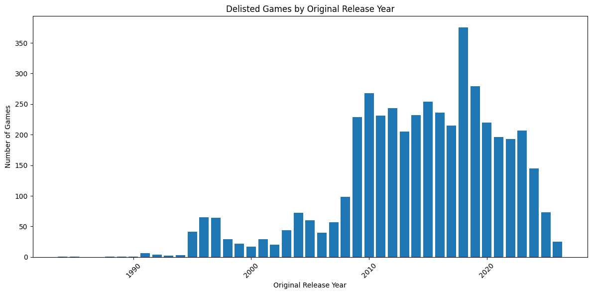
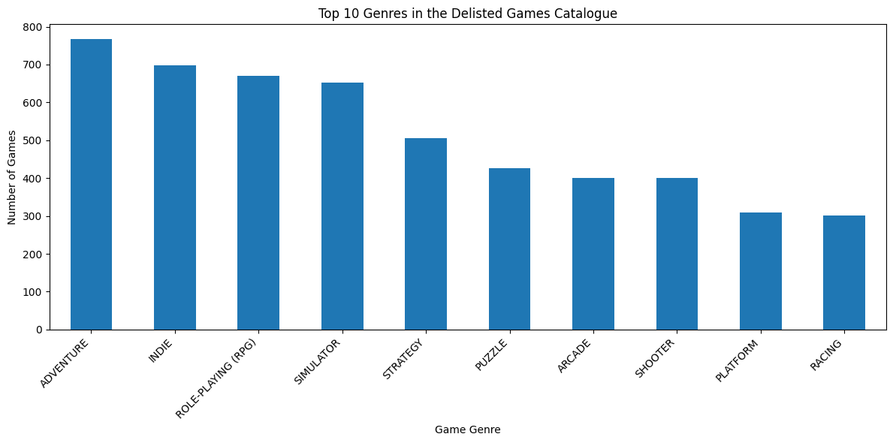
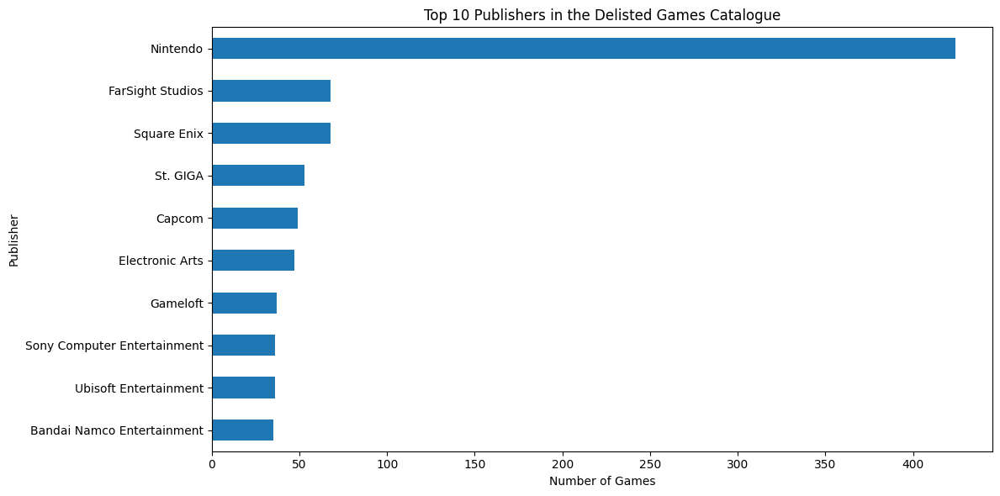
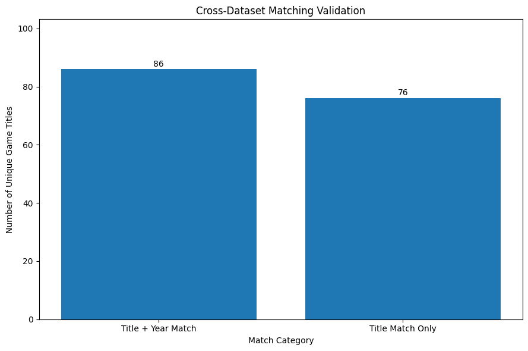
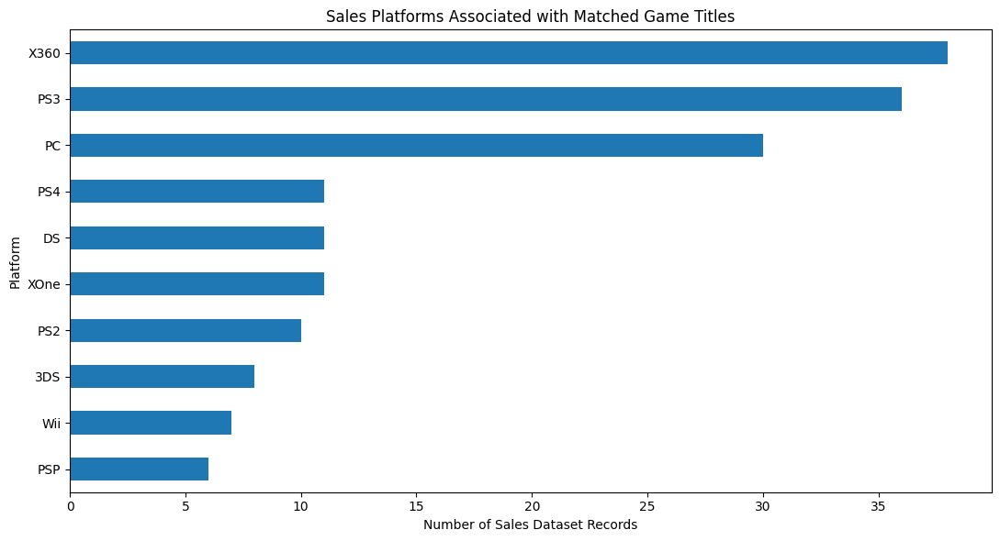

# Do We Still Own Our Video Games?

> An exploratory data analytics project examining digital game delisting, catalogue availability, and the limits of consumer ownership.

  

## Project overview

This collaborative academic project investigates how digital distribution affects long-term access to video games. The workflow combines catalogue collection, data cleaning, exploratory visualization, and cross-dataset matching.

## Results at a glance

| Metric | Saved notebook result |
| --- | ---: |
| Catalogue records collected | 4,968 |
| Video game sales records | 16,598 |
| Matching unique titles | 162 |
| Unique titles matching on title and release year | 86 |
| Duplicate catalogue detail links | 0 |

## Visual analysis

### Original release year

### Genre distribution

### Publisher distribution

### Cross-dataset matching

### Sales platforms associated with matched titles

## Methodology

1. Collect paginated catalogue records using Requests and Beautiful Soup.
2. Clean missing metadata and check duplicate detail links using pandas.
3. Explore release years, genres, and publishers with Matplotlib.
4. Normalize titles and compare matching release years across datasets.

## Limitations

- Title and year matches are candidate matches, not proof of platform-specific delisting.
- Release year is not delisting year.
- The datasets do not identify physical versus digital ownership or license terms.
- Catalogue counts cannot establish industry-wide delisting risk.
- The notebook records 820 unknown publishers, 463 nonnumeric or unknown release years, and one future year excluded from the historical chart.

## Repository guide

- [Analysis notebook](Milestone_2_Game_Data_Collection.ipynb) — contains collection, cleaning, and Milestone 3 analysis with saved outputs.
- [Visualizations](visualizations/) — five original chart outputs recovered from the notebook.
- CSV exports and presentation files are not yet included.

## Data sources

- [Video Game Sales dataset](https://zenodo.org/records/5898311)
- [Delisted Games Tracker](https://project-3b50d.vercel.app/catalog)

## Reproduce the analysis

Open the notebook in Google Colab or Jupyter. Install pandas, requests, beautifulsoup4, and matplotlib. The collection cells depend on the live catalogue; later cells expect the saved catalogue CSV and sales CSV. The notebook preserves the historical outputs even if those external inputs change.

## Contributors

Maryam Adigun Hammed · Ean Pinnock · Jaxon Evans · Sadaya Preston · Jonathan Cruz

Applied Data-Driven Solutions · Kennesaw State University

---

[Portfolio](https://xsadaya.github.io) · [GitHub](https://github.com/xsadaya)
